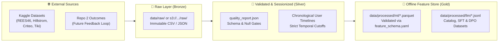

# 🗄️ Data Storage Architecture & Scalable MLOps Pipeline

This document details the data flow from **Raw Ingestion → Schema Validation → Leakage-Free Feature Engineering → Model Training & Registry**. The pipeline follows a **Storage-Agnostic** design so it runs locally via Docker Compose today and scales seamlessly to AWS S3 or Google Cloud Storage in the future via environment variables alone.

---

## 1. Layered Storage Architecture (Medallion-Lite)

### Core Engineering Principles
1. **Immutable `data/raw/` Layer:** Raw Kaggle CSVs are never modified in place. DVC tracks directory content hashes to guarantee reproducibility.
2. **Strict Temporal Split to Prevent Data Leakage (Critical for REES46 Clickstream):**
   - A common mistake on clickstream datasets is aggregating user totals (`total_views`, `conversion_rate`) across the entire 2-month window (`Oct + Nov`) before assigning `purchased_within_7d` labels — leaking future behavior into training features.
   - **How `rees46_processor.py` eliminates leakage:** For every abandoned cart session ending at timestamp $T_{\text{abandon}}$:
     - **Features ($X$):** Computed strictly from events at $t \le T_{\text{abandon}}$ (current session + prior sessions ending before the current session started).
     - **Intent Target ($y_{\text{intent}}$):** Checks whether the user completed any `purchase` event in $(T_{\text{abandon}}, T_{\text{abandon}} + 7\text{ days}]$.
     - **Churn Target ($y_{\text{churn}}$):** Uses an explicit observation cutoff $T_{\text{cutoff}}$; features use events $\le T_{\text{cutoff}}$ while churn is evaluated over $(T_{\text{cutoff}}, T_{\text{cutoff}} + 30\text{ days}]$.
3. **Standardized Parquet Output:** Processed ML tables are stored as compressed Apache Parquet files, reducing storage footprint by 75–85% compared to raw CSVs and preserving exact numeric dtypes when loaded in Google Colab.

---

## 2. Local-to-Cloud Storage Abstraction (`src/utils/storage.py`)

All dataset URI resolution passes through `StorageConfig`:

| Phase | `STORAGE_BACKEND` | `DATA_ROOT` / Bucket URI | Sync Mechanism |
|---|---|---|---|
| **Phase 1 (Current Local)** | `local` | `./data` (mounted into Docker & synced to Google Drive) | DVC local / Google Drive remote |
| **Phase 2 (AWS Scale-Up)** | `s3` | `s3://cart-abandonment-datalake` | `s3fs` + DVC S3 remote + IAM Role |
| **Phase 2 (GCP Scale-Up)** | `gcs` | `gs://cart-abandonment-datalake` | `gcsfs` + DVC GCS remote + Workload Identity |

Migrating to the cloud requires **zero code changes** in `src/data_prep/` or `dags/`: update `.env` (`STORAGE_BACKEND=s3`, `S3_BUCKET_URI=...`) and install `pip install -e ".[mlops]"`.

---

## 3. Versioning & Lineage Matrix (Git + DVC + MLflow)

| Artifact Type | Tool | What Is Tracked? |
|---|---|---|
| **Source Code & Configs** | Git | `src/`, `configs/`, `dags/`, `dvc.yaml`, `tests/` |
| **Datasets** | DVC | Content hashes of `data/raw/` and `data/processed/ml/*.parquet` |
| **Experiments** | MLflow Tracking | Hyperparameters, schema version, metrics (`AUC-ROC`, `AUUC`, `C-index`), evaluation plots |
| **Deployable Models** | MLflow Registry + HuggingFace Hub | LightGBM/XGBoost/CausalML/ONNX artifacts (MLflow), LoRA/Merged LLM weights (HF Hub) |
